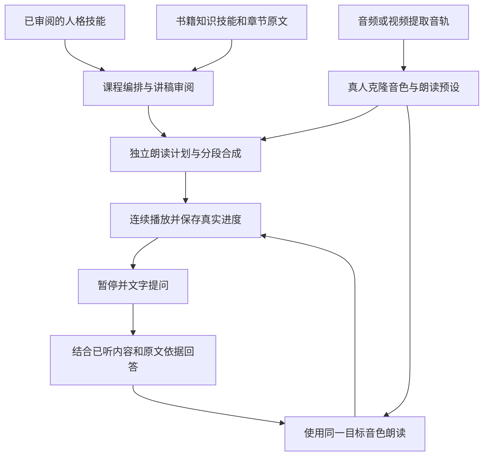

# audio-wiki · 有声 Wiki

将使用者自备的人格技能、书籍知识与真人克隆音色组合成可连续听讲、提问并续播的课程。人格决定怎样思考与表达，书籍决定讲什么及依据，声音决定怎样发声；三者独立管理、组合使用。

第一版是**单用户、自托管的网页程序**，先验收桌面浏览器。软件采用 [MIT 许可](./LICENSE)，不捆绑具体人物、书籍、声音样本或模型权重。

## 当前进度

2026-11-05 建立独立实施仓库，完成项目资料与 Git（版本管理工具）初始化，并归档用户已确认的[首版功能清单](./docs/plan/首版功能清单.md)和[架构设计](./docs/plan/架构设计.md)。下一阶段进入开发任务拆分；当前没有应用代码或可启动服务。

前置声音实验已取得真实克隆结果与用户反馈；后续 MiniMax A、B 两份用户修改短稿已获主观接受，作为接入基线。长章节、字幕定位、课程生成、问答和续播仍待实际验证。详见[前置资料与实验结论](./docs/前置资料与实验结论.md)。

| 入口 | 内容 |
|---|---|
| [当前上下文](./CONTEXT.md) | 已确认决策、当前事实、待定事项与下一步 |
| [首版功能清单](./docs/plan/首版功能清单.md) | 五类页面、跨页面行为、交付批次及验收标准 |
| [架构设计](./docs/plan/架构设计.md) | 技术选择、模块与数据关系、接口契约、任务及播放状态、39 项功能映射 |
| [同类项目与竞品调研](/Users/ssr/project/project-nursery/voice-assistant/audio-wiki/research/2026-11-05-同类项目与竞品调研.md) | 17 个公开产品与开源项目、五个重点对标及待验证的差异 |
| [网页程序实施计划](./docs/plan/网页程序的具体实施计划.md) | 阶段顺序、交付条件、测试与实际验收 |
| [网页首版管线设计](./docs/plan/2026-11-05-Web首版管线设计.md) | 人格、书籍、声音三条准备管线与播放问答流程 |
| [前置资料与实验结论](./docs/前置资料与实验结论.md) | 苗圃描述、实验入口、最新反馈与复用边界 |
| [来源清单](./docs/source-manifest.json) | 初始化读取的源文件、内容校验值及来源仓库状态 |
| [协作规则](./AGENTS.md) | 本项目范围、文档维护与验证要求 |

## 首版目标

首版覆盖资料库、人格与声音、课程工作台、播放与提问、服务设置五类页面。初期导入现成的人格与书籍技能；后端保管服务凭据，持久保存任务、版本、音频和播放位置。音频与视频入口都保留原件及派生来源，提取音轨不等于去除背景音乐。

已确认首节讲稿和声音体验后，后续按有限预取自动生成，仍可暂停审阅或修改。首版允许导入外部处理过的参考音频并保留原版对照，内置人声分离服务延后。

架构采用 Python 后端、独立网页前端和持久化任务工作进程，本机优先并兼容单台服务器。声音先接入 MiniMax，默认采用 B 类停顿预设、A 类换气预设可选；文本模型通过可配置的通用接口接入。具体模块、数据和恢复策略见架构设计。

最先验收一份人格技能、一个书籍章节及知识技能、一个真实克隆音色的完整路径：生成有依据的讲稿 → 审阅 → 分段朗读 → 播放 → 文字提问 → 同音色回答 → 回到原位置。后续再扩展模型数量、内置技能提炼、语音提问、流式首播和移动端能力。

## 开发顺序

沿用前置计划：**功能清单 → 架构设计 → 开发任务拆分 → 可启动应用骨架 → 纵向闭环 → 首版完善 → 实际验收**。

首版功能清单和架构设计已归档，覆盖五类页面及跨页面行为、技术选择、核心数据、接口契约、任务和播放状态、支持格式及部署恢复。下一项工作是依据 39 项功能映射拆分开发任务，先建立可启动基础并完成纵向闭环，再补齐首版。此时尚无安装或启动命令，不将文档规划完成记作应用开发基础阶段完成。

## 仓库与来源

- 本地目录：`/Users/ssr/project/audio-wiki`。
- 远程仓库：[NovenBuilds/audio-wiki](https://github.com/NovenBuilds/audio-wiki)。本地远程名称为 `origin`，地址为 `git@github.com:NovenBuilds/audio-wiki.git`。
- 前置描述：[苗圃项目卡](/Users/ssr/project/project-nursery/voice-assistant/audio-wiki/README.md)。
- 前置声音实验：[实验说明](/Users/ssr/project/evolution_lab/audio-wiki-cloud-comparison/README.md)。

两份计划已承接到本仓库，后续应用实施文档在这里维护。苗圃描述、研究证据及原实验保留在来源目录；其中绝对路径仅适用于原工作机器，其他环境可依据[来源说明](./docs/前置资料与实验结论.md)定位资料。
