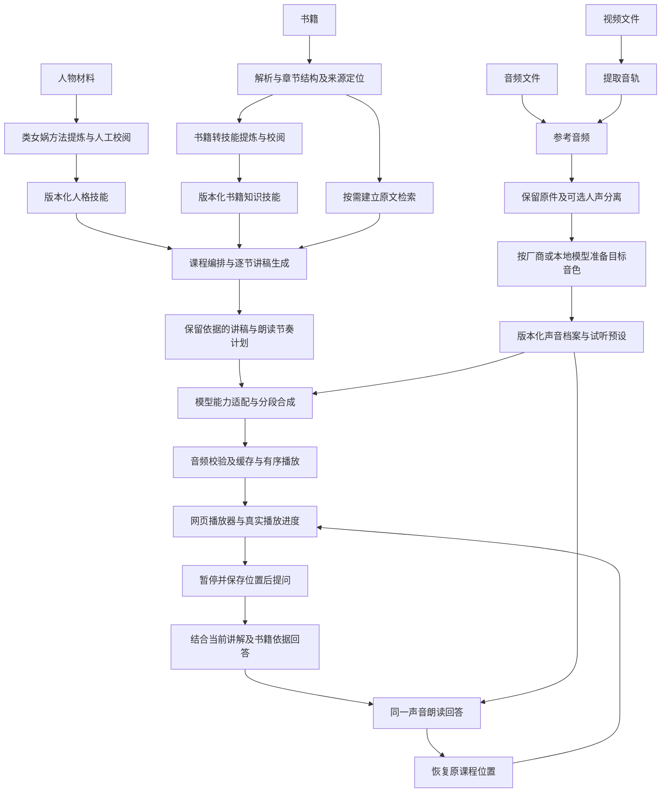

# 有声 Wiki：网页首版管线设计

> 初始化承接说明（2026-11-05）：来自[苗圃原文](/Users/ssr/project/project-nursery/voice-assistant/audio-wiki/plan/2026-11-05-Web首版管线设计.md)。正文保留原规划轮次的阶段描述，只修正来源链接；当前仓库状态见[项目上下文](../../CONTEXT.md)，最新声音反馈见[前置资料与实验结论](../前置资料与实验结论.md)。外部资料链接仅适用于原工作机器；源文件校验值见[来源清单](../source-manifest.json)。

日期：2026-11-05。依据当前项目卡、六款声音模型的实测反馈及本次用户决策整理。本文是设计方案，不代表已经实现或验收。

## 决策与证据边界

- 用户判断：六款模型的实际效果已足以支持进入应用开发；第一版仅做网页程序。
- 已有证据：真人声音克隆可用，已有用户认可的声线；本地 CosyVoice 的节奏与自然度最接近目标，但参考音乐残留尚未解决；云端两款百炼背景干净，但节奏需要调优。六款不是严格统一参考、统一运行环境下的模型排名。
- 开发目标：把人格技能、书籍知识、真人音色连成可连续讲授、提问、续播的产品。人格与知识处理、长章节及打断续播仍待端到端验证，不再以完成全部模型比较为开发前置条件。
- 沿用种子意图：人格提炼采用类女娲方法；书籍知识采用 book-to-skill 方法，必要时原文检索；声音采用真人参考克隆；三项独立组合，材料与服务自备，软件计划采用 MIT 许可。
- 用户已确认：网页界面加用户自托管后端，首版单用户，凭据由后端环境提供，后台任务持久保存。尚未选定具体语言框架、部署机器或独立仓库地址。
- 用户逐项确认：三条准备管线生成可复用资产；内容与朗读节奏分层；按章节组织和语义片段生成；提问使用独立分支并保留进度；资料库、人格与声音、课程工作台、播放与提问、服务设置五类页面；先交付一个完整纵向闭环，再扩展其他能力。
- 用户补充：声音素材入口同时支持直接提交音频文件，以及提交视频文件后提取音轨。两种输入汇合为参考音频，再进入后续处理和克隆。
- 当前苗圃状态不因这份设计自动改为已立项。进入持续开发时另建实施仓库，并建立双向链接。

## 总体管线



三条准备管线不必依次执行，也不应在每次提问时重跑。用户可导入已有的人格技能、书籍技能和已登记音色；网页应支持审阅和修订这些结果。知识技能与人格技能均可复用到不同课程。

## 一、准备人格：怎样思考与表达

1. 导入人物一手材料或已准备好的技能包。
2. 通过类女娲提炼流程，提取思维框架、判断原则、表达特点、反模式与适用边界。
3. 生成可审阅的人格档案，保存材料来源、提炼方法版本、模型与人工修改记录。
4. 课程绑定指定版本；修改档案生成新版本，不悄悄改变正在听的课程。

人格不能只剩一句语气提示，也不能把人格材料里的观点当成书籍作者的原话。人格主要约束讲解方式；书籍事实、直接引文和来源归属须单独保留。

女娲与 book-to-skill 是工作流程和知识组织方法，不是现成的网络接口。首版可以先导入其生成的技能包，再逐步把提炼流程做成后台任务。导入技能只解析受支持文本和引用，不自动执行其中的脚本或任意工具指令。

## 二、准备书籍：讲什么、凭什么讲

1. 保存原文件，计算内容指纹，解析目录、章节、段落、代码／表格等结构。
2. 每个片段保留定位：章节及段落；有可靠页码的格式另保留页码，不为电子书虚构页码。解析不可靠时显示问题并允许修订。
3. 用 book-to-skill 方法提取框架、原则、方法、适用条件和反模式，并保留章节映射与原文依据；不能仅生成摘要。
4. 对需要精确细节、跨章问答或超出技能包的问题，建立并使用原文检索。首版可先按章节取原文，搜索能力随实际需要增加，不强制每本书都上向量数据库。
5. 对已导入技能但没有原书的情况，明确只能依据技能回答，无法定位原书的细节应说明依据不足。

正文、提炼结果和检索片段作为资料处理，不能覆盖应用运行规则。发现提炼失真应能回到原书修订，而不是反复让模型复述错误摘要。

## 三、准备声音：用谁的声音、怎样读

1. **统一素材入口**：支持直接提交音频文件，也支持提交视频文件。视频先检测音轨，再提取为独立音频；没有音轨、文件无法解码时提示具体原因，多音轨时允许选择目标音轨。具体支持格式以实际解码能力与首版验收清单为准。
2. 原始音频／视频均保留且不覆盖；提取的音轨作为派生资产，记录源文件、音轨、提取参数与内容指纹。界面支持试听及选择参考时间片段，保留原文件中的时间范围。视频在用户自托管后端处理，声音模型接收所需参考音频。
3. 检查截断、削波、静音与背景问题。**提取音轨不等于去除背景音乐**；人声分离为可选分支，保留提取音轨与处理版供对照，不把多个增强器无条件串联。最后按选定模型要求转换音频规格。
4. 按模型要求建立声音档案：云端登记厂商音色标识；本地模型可能使用参考音频、参考转写和缓存特征，不要求所有模型都存在同一种“克隆接口”。
5. 用同一小段讲稿试听，分别记录声线、背景、语速、停顿与自然度。满意后保存“声音版本＋朗读预设”。

声音档案必须区分厂商、型号、账号／空间、参考音频及处理版本。MiniMax 音色标识不能拿去百炼使用，同一厂商不同型号也不能默认通用。更换参考处理或克隆降噪配置，应形成新版本，而非误用原缓存。

当前建议：保留本地 CosyVoice 原本受到认可的节奏；云端百炼优先调优慢速与停顿；MiniMax 的克隆降噪另作可选对照。不提前指定六款中的最终赢家。

## 四、生成课程：把知识变成适合听的内容

用户选择“书籍版本＋人格版本＋声音版本＋讲解深度／顺序”，创建课程。

后台先形成整书课程目录，再逐节生成讲稿：每节的学习目标、关键概念、例子、章节依据与衔接关系都可审阅。首节优先生成，之后少量预取，避免未听就整本付费合成。

内容生成须区分作者观点、讲解者解释和新增例子。人格影响解释和判断方式，但不能冒充作者、改写事实或编造原书案例。问答时优先取当前听到的段落及必要上下文，不把尚未播到的预生成内容当成用户已经听过。

讲稿保存结构化段落、稳定段落标识和出处。屏幕展示完整依据；朗读通常只读自然讲解，不把每条检索编号或文件路径念出来。

## 五、朗读节奏编排：独立于讲稿内容

设置独立的“朗读计划”，包含语义句群、读音修正、目标语速、句间／段间停顿和少量表达要求。

- 原始讲稿和朗读变换分开存。英文缩写、公式与代码可生成可读说明，并能回查原文；不要只把技术内容逐字符念出。
- 以完整语义句群切分，按模型限制调整；避免逐字调用，也避免整章一个请求。过碎会破坏连贯性，过长则增加首播等待和失败重做成本，具体长度需实测确定。
- 内部使用统一的停顿意图，由模型适配器转成各家的标记。模型内部停顿和音频段之间的静音只选明确负责的一层，避免重复加停顿。
- 对没有原生语速／停顿能力的模型，明确显示限制；必要时采用分段插静音或生成后调速，并记录这是后处理。不能假装所有模型都有相同参数。

| 路线 | 首版需要保留的能力差异 |
|---|---|
| 本地 Qwen3-TTS 1.7B / 0.6B Base | 当前核查未见原生语速与精确停顿入口；使用语义标点、合适分段，必要时后处理 |
| 本地 Fun-CosyVoice3-0.5B-2512 | 非流式路径可调语速；无已核验的独立去音乐开关；保留原速作为基线 |
| MiniMax 2.8 HD | 原生语速、专用停顿标记；克隆阶段降噪与合成参数分开 |
| 百炼 Qwen 3.1 TTS Plus | 原生语速、表达指令、语音合成标记语言；适配器处理实际提交约束 |
| 百炼 CosyVoice 3.5 Plus | 同类控制；复用已跑通的完整事件流接收方式 |

上表来自[前轮官方核查](/Users/ssr/project/project-nursery/voice-assistant/audio-wiki/research/2026-11-04-背景音乐清理与语速停顿控制核查.md)，不是本轮新跑参数实验。

## 六、合成、缓存与播放

每段先落任务记录，再请求模型，收齐结果并检查可解码、实际时长及结束状态。供播放器使用的音频须有明确格式，不能把厂商网络帧直接当可播放片段。已有一次性完整片段路径后，再优化模型支持的流式首播。

接收音频、写盘与合成是不同步骤。下载失败应先尝试恢复既有结果，不能直接重合成；对超时且厂商结果未知的任务先核对状态，无法核对则标为待确认，避免自动重复计费。解码成功不能证明无漏读，异常短片段需要提示复核。

音频缓存身份包括讲稿内容、朗读计划、模型精确版本、声音版本和前后处理设置，另按使用者隔离；不存原始密钥。内容／人格修改通常只使受影响段落及其衔接失效，更换声音则使对应音轨失效，原书解析和技能仍可复用。

播放器按课程顺序播放少量已就绪片段，并记录真实播放位置；后台生成到哪里不等于用户听到哪里。首版采用有限预取、任务优先级和预算上限，模型失败允许重试原路线或由用户选择更换，不能自动换音色。

## 七、提问与续播

首版核心交互为“点击提问→暂停→文字提问→听回答→继续课程”。增加按住说话与自动语音识别作为下一步；网页麦克风权限、识别准确性和回声处理单独验证，不以始终监听作为开工前置条件。

暂停时保存课程／讲稿版本、段落标识、片段标识和段内已播放时间；保留最近已听内容及提问上下文。提问使用独立回答分支：当前听讲位置＋人格技能＋书籍技能＋按需检索→回答文本→同一朗读管线。

原课程音轨与回答音轨分开。回答时只切换播放分支，不修改课程目录与原进度。结束后恢复原位置，提供“从本句重听”选项，不默认重讲整章。

暂停与取消不同：用户暂停不必丢弃已生成课程音频；中断回答则立即停止播放，尽力取消上游，已计费请求不能保证撤回。使用会话代次标识丢弃迟到的旧回答，防止旧声音突然播出。

## 网页首版的系统边界

```text
浏览器：资料与技能管理、课程配置、讲稿与出处、播放器、提问、任务状态
  ↕
用户自托管应用后端：课程编排、版本与进度、凭据引用、能力适配、任务调度
  ├─ 后台工作进程：视频音轨提取、解析、技能提炼、检索、内容生成、音频合成与校验
  ├─ 元数据存储：版本、章节、任务、会话、播放锚点、用量
  ├─ 私有文件存储：原件、技能包、处理版参考与缓存音频
  ├─ 云端模型接口：用户配置的语言模型、语音合成与可选识别服务
  └─ 本地推理服务：可在另一个有图形处理器的 Windows／Linux 主机运行
```

- 浏览器不保存服务密钥、不直接承担长任务。首版由实例所有者在后端环境配置凭据，页面显示连接和模型状态；未来再讨论多人输入和代管密钥，不把当前本机环境文件复制进产品。
- 首版是单体应用加可独立运行的工作进程：共享业务与存储，任务状态持久化，不急于拆微服务。网页关闭后任务可继续，重新打开可恢复状态。
- “网页版”不表示本地权重在浏览器里跑，也不表示 Mac 一定能跑所有本地模型。模型服务地址可指向用户的 Windows 实验机；连接权限和网络配置随部署确定。
- 原件及音频保持私有，只向当前使用者授权访问；对外部署需要认证和传输加密。使用云端服务时明确对应资料会发送给所选服务，自托管不等于完全离线。
- 首版不承诺手机浏览器后台长时间播放；先验收桌面浏览器，移动端前台适配与后台行为随后实测。

## 开发顺序与首版验收

1. **跑通纵向闭环**：一份已审阅人格技能＋一本书的一个章节及知识技能＋一个真实克隆音色，网页创建课程、生成讲稿、播放、文字提问、回答后续播。先复用已验证的模型接入，不要求六款全部集成才能开始。
2. **完善输入准备**：补齐书籍解析与技能提炼任务、来源追溯、人格档案审阅、音频导入与视频音轨提取、参考片段选择、参考音频处理与试听预设；全程保留导入已有结果的路径。
3. **完善替换和可靠性**：增补其余候选模型、本地推理连接、按需检索、缓存失效、任务恢复、费用记录和长章节连续播放。
4. **改善交互**：按住说话、流式首播、移动端；始终监听、自动回声消除与更复杂多端同步延后。

首版验收覆盖：用户接受声音与节奏；讲稿体现人格且有书籍依据；连续播放完整章节；在段中提问后回到原位置；刷新后恢复课程及进度；模型超时／下载失败不悄悄重复合成；改一项配置只重做受影响产物。验收时记录真实等待、费用和失败，不预填“通过”。

素材入口另验收：音频可直接进入参考处理；带音轨视频可提取并试听、选择参考片段；无音轨／损坏文件给出明确错误；多音轨选择正确；来源与片段时间可追溯，原始文件不被覆盖。原视频及其他大型媒体遵循仓库资产外置规则。

## 来源

- [当前种子描述](/Users/ssr/project/project-nursery/voice-assistant/audio-wiki/README.md)，以及本轮用户对首版网页形态的明确要求。
- [本地模型实验与用户反馈](/Users/ssr/project/project-nursery/voice-assistant/audio-wiki/research/2026-11-04-开源本地模型实验记录.md)、[云端实测](/Users/ssr/project/project-nursery/voice-assistant/audio-wiki/research/2026-11-04-云端克隆模型实测记录.md)、[背景清理与节奏能力核查](/Users/ssr/project/project-nursery/voice-assistant/audio-wiki/research/2026-11-04-背景音乐清理与语速停顿控制核查.md)。
- 已核对本机女娲、book-to-skill 的方法说明；本轮未执行提炼、安装、模型调用或应用开发。六项总体设计与音视频素材入口已获用户明确确认；其余未明确确认的实现细节仍属工程建议，所有功能均待实现与验收。
