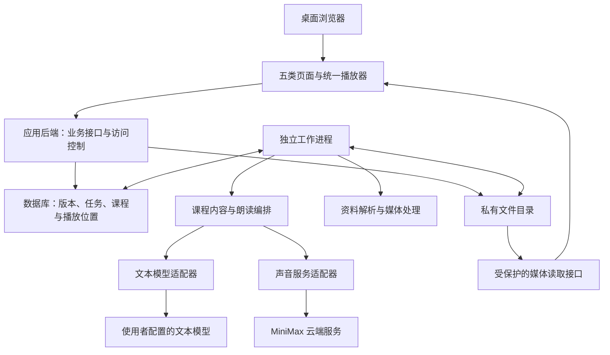
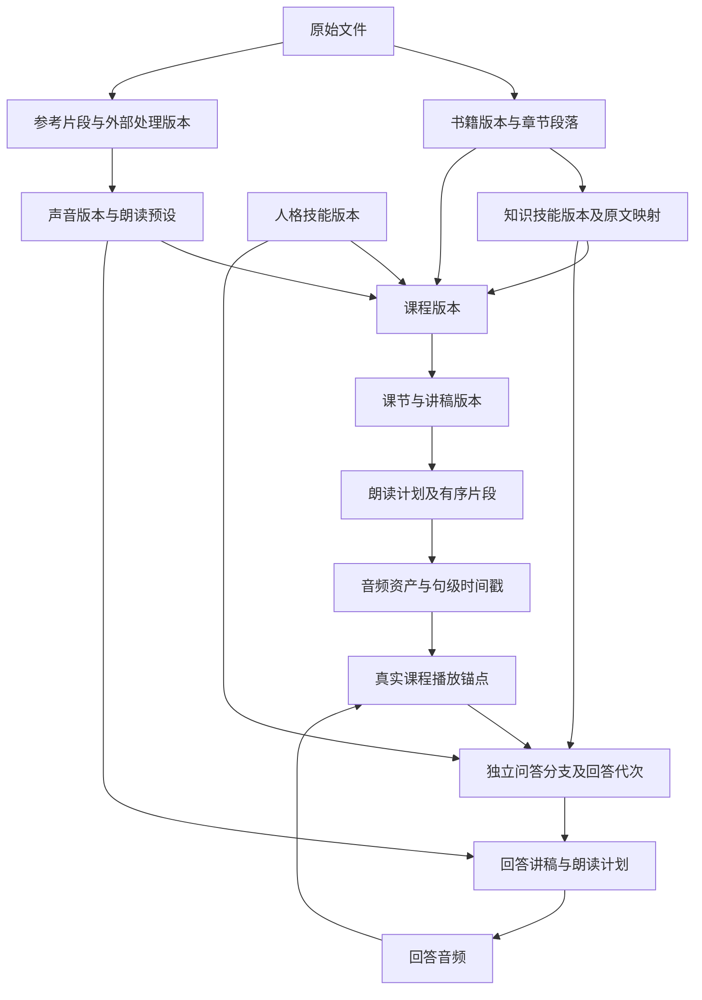
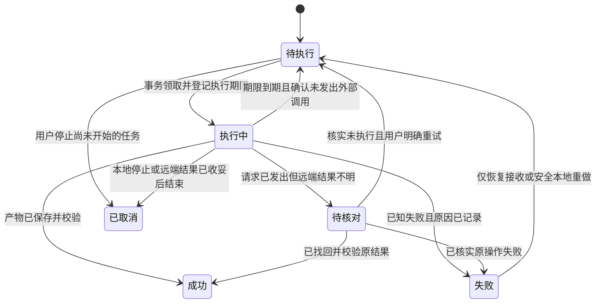
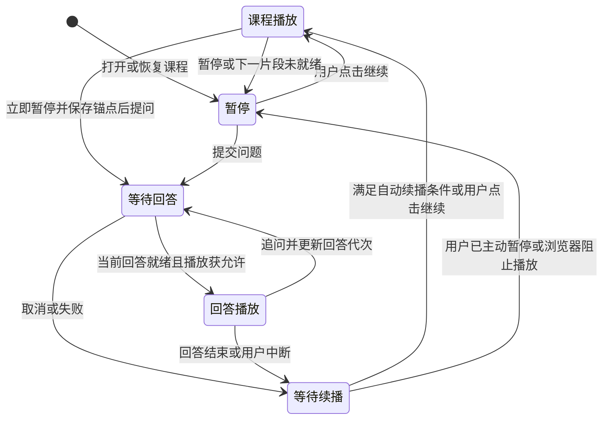

# 有声 Wiki 首版架构设计

日期：2026-11-05。
文档状态：用户已确认的首版架构规划，尚未实现或进行应用验收。
依据：[首版功能清单](./首版功能清单.md)、[网页程序实施计划](./网页程序的具体实施计划.md)、[网页首版管线设计](./2026-11-05-Web首版管线设计.md)及本轮用户确认。
当前执行状态见[项目上下文](../../CONTEXT.md)，最新声音证据见[前置资料与实验结论](../前置资料与实验结论.md)。

## 一、设计目标与技术选择

本设计覆盖已确认的 39 项首版功能，为下一阶段开发任务拆分提供模块、数据、接口与恢复策略。目标是将人格技能、书籍知识和真人克隆声音组合为连续讲授、文字提问、同音色回答及原位置续播的完整路径。

### 已确认的方向

- 单用户、自托管网页程序，先验收桌面浏览器。本机运行优先，同时支持迁往单台服务器。
- Python（后端开发语言）与独立网页前端。首个声音服务接入 MiniMax；文本模型采用可配置的通用兼容接口。
- 书籍支持纯文本、Markdown（轻量标记文本）、EPUB（电子书格式）和文字型 PDF（可直接提取文字的文档）。
- MiniMax 默认采用 B 类语义分段与少量定时停顿预设，A 类换气发声预设保留可选。
- 首节讲稿及声音体验经用户确认后，后续按有限预取自动生成，仍可暂停审阅和修改。
- 首版导入现成人格及书籍知识技能；参考音频支持导入外部处理版。完整自动提炼、内置人声分离、语音提问、流式首播、多用户及原生客户端延后。

### 技术组合与约束

| 层次 | 选择 | 职责 |
|---|---|---|
| 网页前端 | 网页界面库 React、带类型的前端语言 TypeScript、构建工具 Vite | 五类页面、讲稿审阅、播放器和问答交互 |
| 应用后端 | Python 3.12、接口框架 FastAPI、数据校验库 Pydantic | 业务规则、输入校验、版本管理和访问控制 |
| 后台执行 | 与后端共享业务代码的独立工作进程 | 文档解析、媒体处理、内容生成、声音克隆和合成 |
| 数据存储 | 文件型数据库 SQLite、数据库映射工具 SQLAlchemy、迁移工具 Alembic | 保存版本、课程、任务、进度和用量 |
| 文件存储 | 本地私有目录 | 保存原件、派生文件、讲稿、字幕及音频 |
| 外部调用 | 网络请求库 HTTPX，以及独立的模型适配器 | 统一超时、结果接收和凭据访问 |
| 媒体处理 | 音视频工具 FFmpeg、媒体探测工具 ffprobe | 检测音轨、提取参考、规格转换及解码校验 |

基于单用户、单机部署的前提，任务直接持久化到 SQLite，首版不增加独立消息服务。数据库使用预写日志模式（WAL，先记录变更再归并数据库的写入方式）；应用与工作进程位于同一主机、访问同一块本地存储，不将数据库放在跨主机共享文件系统。运行环境要求 SQLite 3.51.3 或更新版本，以包含官方公布的日志重置问题修复。[SQLite 官方说明](https://www.sqlite.org/wal.html)

开发使用独立的 Python 3.12 环境与 Node.js 24（前端开发和构建运行环境），分别锁定后端和前端依赖，不修改系统默认运行环境。具体依赖补丁版本在开发基础阶段通过安装、构建及检查后写入锁定文件；此处不将尚未创建的依赖清单当作已验证环境。

### 关键决策及适用边界

| 决策 | 原因与边界 |
|---|---|
| 单体业务代码加独立工作进程 | 同一套规则和数据模型便于维护；长任务可以独立运行，不依赖请求进程或网页生命周期 |
| SQLite 加本地私有文件 | 对应首版单用户、单主机的部署目标；跨主机工作进程及水平扩展留待后续重新设计存储与队列 |
| 独立前端、正式运行同源提供 | 开发时分工清楚；正式运行时统一网页、接口与媒体访问入口 |
| 通用文本接口加 MiniMax 首接入 | 文本模型由使用者配置，声音先复用已验证实验逻辑；不代表其他服务已经接入或 MiniMax 是最终效果赢家 |
| 先完整片段，再优化流式首播 | 先保证完整接收、校验、可恢复和有序播放；实际等待时间通过闭环实测记录 |
| 版本化资产与独立回答分支 | 更换一个环节能复用其他资料，回答不覆盖课程进度 |

[同类项目与竞品调研](/Users/ssr/project/project-nursery/voice-assistant/audio-wiki/research/2026-11-05-同类项目与竞品调研.md)中的 Open Notebook 复用建议继续保留为未完成的评估事项。该调研在本轮检查期间已迁回苗圃，沿用当前来源位置。本轮按用户确认的架构记录设计，不声称已完成竞品运行、代码复用审查或独立实施成本比较。

## 二、系统结构与模块边界

### 模块职责

| 模块 | 负责内容 | 对应功能 |
|---|---|---|
| 资料管理 | 原件、章节、段落、知识技能、来源定位及版本 | 资料01—06 |
| 人格与声音 | 人格技能、参考素材、声音档案、朗读预设及试听 | 人声01—08 |
| 课程编排 | 课程目录、讲稿、首节确认、朗读计划和局部重做 | 课程01—08 |
| 播放与问答 | 播放队列、真实进度、回答分支、追问和续播 | 播放01—07 |
| 服务配置 | 后端配置引用、模型能力、生成范围和运行记录 | 设置01—04 |
| 任务与存储 | 持久化执行、失败恢复、产物复用、访问保护及部署恢复 | 通用01—06 |

应用后端只处理短事务和任务提交；工作进程调用同一套业务规则与模型适配器。解析、媒体处理、内容生成及声音任务不在请求处理过程中等待完成，也不将进程内临时后台任务作为唯一执行记录。[FastAPI 后台任务说明](https://fastapi.tiangolo.com/tutorial/background-tasks/)

前端与后端分别开发，正式运行时由后端提供构建后的网页，网页、业务接口及媒体接口统一访问来源。存在活动任务时前端每两秒轮询任务状态；离开页面后后台执行不受影响。

浏览器负责交互、实际播放及待同步进度，不保存服务密钥。后端和工作进程负责课程规则、任务记录与外部调用，文件处理工具不直接决定课程版本或播放状态。

## 三、核心数据与接口契约

### 数据身份与关系

所有可修订资产采用“稳定身份＋不可变版本”。编辑产生新版本，课程继续绑定原版本，直到使用者明确创建或切换课程版本。审阅状态与业务状态独立记录，不因生成成功自动认定内容已通过人工验收。

| 对象组 | 保存的核心信息 |
|---|---|
| 原始与派生资产 | 文件身份、内容校验值、类型、存储位置、来源资产、处理方法及版本 |
| 书籍与原文 | 书籍版本、章节顺序、段落标识、正文，以及可靠的页码或电子书位置 |
| 知识与人格技能 | 原始导入内容、结构化内容、来源、修订记录和审阅状态 |
| 声音与朗读预设 | 服务配置引用、型号、声音版本、参考版本，以及语速、停顿和换气设置 |
| 课程与课节 | 绑定的资产版本、讲解深度、课节目标、来源章节和首节确认状态 |
| 讲稿与朗读计划 | 稳定段落标识、作者观点与解释的区分、原文依据、朗读片段及渲染结果 |
| 音频与句子定位 | 音频格式、时长、校验值、合成参数、句级时间戳及验证状态 |
| 播放与问答 | 课程位置、回答分支、追问关系、播放会话和回答代次 |
| 任务与调用尝试 | 输入版本、阶段、优先级、执行归属、外部请求编号、用量及恢复信息 |

图中的“回答音频回到课程锚点”表示恢复动作，不表示回答进度写入课程锚点。原文引用、讲稿段落与句级字幕分别保存映射；无法准确映射时保存问题状态，不补造页码或时间。

服务配置使用稳定的账号／空间身份隔离声音和缓存。更换账号必须建立新的配置身份；同账号轮换密钥不强制丢弃既有声音资产。原始密钥不进入业务记录或缓存身份，页面只显示配置别名及脱敏状态。

### 对外接口

业务接口统一使用 `/api/v1` 前缀，由后端生成接口说明及前端类型定义。下表是首版接口契约，尚无可调用的应用接口；具体请求模型随开发任务落实，并以同一份后端数据定义生成前端类型。

| 接口组 | 最小契约 |
|---|---|
| 资料与技能 | 上传原件、创建及读取版本、修订章节、查看来源和引用关系 |
| 声音 | 登记已有音色、创建克隆任务、生成试听、保存声音及预设版本 |
| 课程 | 创建课程版本、生成目录与讲稿、确认首节、暂停生成、局部重做 |
| 问答 | 提交问题时同时保存课程播放锚点，返回回答身份及任务身份 |
| 播放进度 | 保存及读取课程版本、讲稿版本、课节、片段和段内毫秒位置 |
| 任务与服务 | 查询状态、停止后续执行、发起允许的恢复操作、查看脱敏配置 |
| 媒体 | 按资产身份授权读取，支持按字节范围请求，满足拖动播放 |

长任务提交成功返回“已受理”及任务身份，音频就绪通过任务状态体现。创建、生成、确认和提问接口支持幂等请求标识，即重复提交同一请求返回原任务，不重复创建。相同标识但内容不同，或编辑基于过期版本时，返回明确冲突。

播放锚点至少包含下列信息：

| 信息 | 用途 |
|---|---|
| 课程版本、讲稿版本 | 保证恢复到实际播放过的内容版本 |
| 课节、音频片段、段内毫秒位置 | 定位有序队列及实际播放时间 |
| 播放会话、递增序号 | 拒绝同会话迟到的位置更新，避免旧位置覆盖新位置 |
| 当前回答代次 | 判断回答是否仍属于当前交互；不把回答位置作为课程位置 |

后端按当前播放会话核对更新；不同会话的序号不能直接比较。新会话明确接管播放后，旧会话不再写入课程锚点。提交问题的事务同时保存锚点、创建回答分支和排入任务，避免位置已保存但问题未建立或相反的部分状态。

### 内部适配器边界

- 文本适配器接受任务类型、人格和知识版本、必要原文及问题上下文，返回待校验的目录、讲稿或回答，以及可取得的请求编号和用量。
- 声音适配器声明音色准备、语速、停顿、表达、字幕、流式与取消能力，接受声音版本及朗读计划，返回音频接收信息、句级定位和用量。
- 恢复操作区分安全的本地重做、查询远端状态、继续接收已有结果和需要人工核对。适配器不能把所有失败统一转换为重新合成。
- 服务能力不存在时明确显示限制；不得静默替换模型、账号、声音或改用系统朗读。

## 四、关键流程与可靠性

### 1．资料和声音准备

- 原件先保存并计算校验值，再创建解析或处理任务；派生结果保留完整来源链。
- 书籍支持纯文本、Markdown、EPUB 和文字型 PDF。电子书按阅读顺序组织；PDF 保留物理页码及提取结果供校阅；章节与正文可人工修订。扫描件识字和复杂版面还原不进入首版。[PDF 文字提取边界](https://pypdf.readthedocs.io/en/stable/user/extract-text.html)
- 技能支持文本文件及包含 `SKILL.md` 和文本引用的压缩包。只读取支持的文本内容，其他文件列为未导入项，不执行脚本。解包限制在导入目录内，不能按压缩包内路径覆盖现有资产。
- 音频支持 WAV（波形音频）、MP3（压缩音频）、FLAC（无损音频）、M4A（音频容器）；视频支持 MP4、MOV、MKV 三类容器。扩展名不代表实际编码可处理，音轨及编码必须经过探测和解码验证，多音轨由使用者选择。
- 外部处理音频作为新资产导入，关联原件与参考范围；原件始终保留。提取音轨、人声处理、规格转换和声音克隆分别记录。
- 新建音色与登记已有音色都需核对服务、型号及账号身份。参考片段或克隆设置变化建立新声音版本，不覆盖既有记录。

### 2．课程、讲稿与朗读

课程先形成目录，再生成首节讲稿。使用者审阅讲稿、确认合成并接受首节声音后，才开启后续自动生成。首节确认绑定具体讲稿、声音与预设版本，版本变更后不能沿用不相符的确认结果。

文本模型适配器首版使用兼容的聊天生成接口，由后端配置服务地址、型号和密钥。输出统一校验为课程目录、带依据的讲稿或回答；不强制所有服务支持同一种结构化输出参数。[聊天生成接口参考](https://developers.openai.com/api/reference/resources/chat)

原文引用必须指向实际存在的章节或段落；结构不合法或引用不存在时停止后续合成并显示问题。引用身份有效仍不等于语义正确，内容质量保留人工验收。模型上下文按当前任务选取知识技能和必要原文，输入过长时调整章节范围或分段，不能无提示地截掉来源。

讲稿与朗读计划分开保存。以完整语义句群组织合成片段，避免逐字调用；片段长度作为可调整策略，通过实际试听确定。公式、英文缩写和代码的朗读变换保留原文对应关系；来源定位用于屏幕查阅，不把文件路径机械读入音频。

MiniMax 接入采用以下基线：

- 型号 `speech-2.8-hd`，先使用非流式合成，保存完整可验证音频后播放。
- 沿用已接受短稿的语速 0.9、音量 1、音调 0；默认 B 类语义分段与少量定时停顿，A 类换气发声预设可选。
- 停顿与换气保存在朗读计划中，再由适配器转换成厂商标记，不机械复制短稿中的标签密度。既有短稿使用的降噪开启音色按其声音版本登记；克隆阶段设置与合成阶段设置分别保存。
- 首版启用句级字幕，保存并校验时间戳，用于“从当前句重听”。字幕异常时明确显示句子定位不可用，保留普通定位及片段重听，不伪造句子时间；句子定位在正式交付前仍需通过正常路径的真实验证。[MiniMax 合成接口](https://platform.minimax.cn/docs/api-reference/speech-t2a-http)

A、B 的接受结论仅来自[前置实验的短稿记录](/Users/ssr/project/evolution_lab/audio-wiki-cloud-comparison/README.md)和[用户主观接受记录](/Users/ssr/project/project-nursery/voice-assistant/audio-wiki/research/2026-11-05-无显式停顿语速对照与起音检查.md)。实际 A 为 3 处换气、35.724 秒，B 为 4 处 0.35 秒停顿、32.851 秒，二者正文和标签不同，不是严格单变量对照。新增字幕接收、长章节及应用交互仍需真实验证，不把短稿接受外推为整章通过。

### 3．后台任务和恢复

任务状态区分待执行、执行中、成功、失败、待核对和已取消。等待首节确认、达到用量限制分别作为业务等待条件记录，不混同任务执行失败。

- 使用数据库事务领取任务，记录执行归属和有效期限；工作进程定期续期。网络调用期间不持有数据库写事务。
- 外部调用前保存调用尝试；返回结果先保存到私有临时文件，再校验并登记为正式产物。文件保存后、数据库确认前重启，应核对既有文件并完成登记，不能直接重新请求。
- 重启后，本地处理任务可以重新执行；已经发出且结果不明的计费请求进入待核对，不能因执行期限到期自动重发。无法判断请求是否已发出时采取待核对状态。
- 已有结果接收失败时只恢复接收；MiniMax 同步请求若没有取得可恢复结果，不假设存在可查询的远端任务。网络请求层不配置隐式重发计费请求的机制。
- 首版默认同时执行一个计费生成请求。优先级为回答、当前播放所需内容、后续预生成；已发出的请求不强行中断。
- 用户停止生成后，不再领取相应后续任务；已发出的调用保留实际结果和用量。停止等待不等于服务端已取消，结果不明仍须核对。
- 自动预取默认最多提前一个课节。课程生成批次默认上限为一万提交文本字符，可调整；此限制与厂商计费字符、文本模型用量及实际金额分别记录。预留中的调用也参与范围检查，避免多个任务各自判断额度而超出限制。

缓存身份包含实际提交内容、相关版本、模型、账号空间、声音、朗读参数及前后处理设置。内容生成另外保留提示模板与生成配置版本。修改只使依赖变化的产物失效；替换声音复用书籍解析及知识技能，旧课程版本继续引用旧产物。

### 4．播放、提问与续播

播放器同一时间只允许一个分支发声。前端采用明确状态转换，异步完成事件携带播放会话、课程版本和回答代次，只有仍匹配当前交互的事件可以改变播放。

- 正常播放定期保存位置；暂停、拖动、切换课节和提问时立即保存。浏览器保留待同步位置，重新连接后按序号补交；恢复的是已记录位置，不能用后台生成进度或未采样的时间推算。
- 点击提问立即暂停；后端在一次事务中保存课程锚点、建立回答分支并提交任务。提交失败保留问题文本，取消提问可回到原位置。
- 回答依据已听内容和当前句上下文生成，未播放的预生成讲稿不记为已听内容。回答保留人格版本、知识版本和原文依据，使用课程绑定的目标声音。
- 连续追问更新回答代次。迟到的旧回答可以保留记录，但不能进入当前播放，也不能覆盖课程锚点。
- 回答结束仅在使用者未主动暂停或中断时自动续播。刷新后及浏览器阻止自动播放时，由使用者点击继续。
- “从当前句重听”使用已验证的句级时间戳定位；没有有效时间戳时明确禁用该定位能力，并提供片段重听。
- 已开始播放的课程绑定固定版本；修改讲稿后须明确切换版本，不能把新旧音频拼入同一队列。下一片段未就绪时显示等待或失败状态，不跳过片段继续播放。

## 五、部署、验收与文档交付

### 部署与数据保护

本机模式默认仅监听本机地址。服务器模式采用单个所有者登录、受保护的会话和加密访问，网页与接口保持同源；不提供注册或多用户管理。访问保护同时作用于业务接口、原文、参考媒体、字幕及生成音频。

提供原生开发方式及 Docker Compose（容器服务编排）部署方式。正式运行包含应用和工作进程两个服务，共享私有数据卷；服务器模式增加反向代理。前端只在构建和开发时需要 Node.js，正式运行由后端提供已构建网页。后台凭据由运行环境提供，媒体目录不作为公开静态目录。

数据库迁移在应用与工作进程启动前单独执行。备份进入维护状态，停止新增写入及任务领取，处理完在途任务或明确记录其待核对状态，再保存数据库与对应文件。恢复必须验证数据库引用、文件校验值及任务状态，不能只确认数据库文件可以打开。初始化[来源清单](../source-manifest.json)作为历史快照保留，不因后续资料更新而覆盖。

### 验收场景

以下均为开发阶段必须执行的验收场景，本次文档落盘不将它们记为已运行或通过。记录实际首播等待、回答等待、章节连续播放及用量，不预填未经验证的性能目标。

| 场景编号 | 范围 | 通过条件 |
|---|---|---|
| 验01 | 单章原文、知识技能、来源及版本 | 导入与修订后正文完整、版本可追溯；有效依据可定位；无原书时明确回答依据范围，不生成虚假页码 |
| 验02 | 整书与格式解析 | 文本、电子书和文字型 PDF 正确导入；扫描件、不支持格式、损坏文件及章节缺失明确提示，人工修订后才能作为可靠来源 |
| 验03 | 人格技能与导入边界 | 思维、表达和适用边界可审阅；修订生成新版本；压缩包路径受限，脚本不执行，已有课程不被静默修改 |
| 验04 | 声音登记、克隆与隔离 | 服务、型号、账号和参考版本对应正确；音色不可用时明确失败；创建状态不明不重发；新声音保留旧版本 |
| 验05 | 音视频及参考处理 | 单／多音轨可正确选择，无音轨及损坏文件明确失败；原件与外部处理版保留，参考时间及处理来源可追溯 |
| 验06 | 课程、讲稿及首节确认 | 完成单章到目录、带依据讲稿的路径；首节内容和声音未确认不扩展自动生成；结构或引用无效时不合成 |
| 验07 | 朗读、音频与字幕 | 讲稿和朗读变换分离；完整音频可校验；有效字幕支持句子重听，字幕缺失或异常时不伪造位置；声音质量另经用户试听 |
| 验08 | 连续播放与恢复 | 多片段顺序正确，无丢段、重复或乱序；未就绪时等待；进度乱序不覆盖新位置；刷新、重启、自动播放受阻后可由用户继续 |
| 验09 | 提问、追问及回答分支 | 段中提问保存原位置，同音色回答后正确续播；主动暂停或中断不擅自播放；旧回答迟到、连续追问和重复提交不破坏课程位置 |
| 验10 | 任务故障、恢复及优先级 | 外部请求发出前后、结果写盘前后分别终止工作进程；安全本地任务可恢复，未知计费结果待核对；接收失败不重合成；回答优先于未开始的预生成 |
| 验11 | 局部修改、缓存和生成上限 | 改讲稿只重做受影响产物，换声音复用知识；不混播版本；提前课节数及提交字符上限生效，已预留调用参与检查 |
| 验12 | 配置、访问、诊断与部署恢复 | 全新环境可依说明运行；后端配置可诊断；服务器未登录不能访问资料；密钥不进入浏览器或日志；备份恢复校验引用、文件和任务状态，用量未知如实显示 |

离线自动检查、真实服务验证、用户试听和完整交互验收分别记录。离线替代服务可验证任务、参数和状态转换；真实服务验证最终音频、句级字幕及用量；用户分别评价内容依据、人格表达、音色、节奏、背景和完整性。

### 39 项功能与模块、数据及验收的对应关系

| 功能编号 | 功能 | 主责模块 | 核心数据对象 | 验收场景 |
|---|---|---|---|---|
| 资料01 | 导入章节原文 | 资料管理 | 原始资产、书籍版本、章节段落 | 验01 |
| 资料02 | 导入书籍知识技能 | 资料管理 | 知识技能版本、章节及原文映射 | 验01 |
| 资料03 | 审阅与修订资料 | 资料管理 | 资料版本、修订及审阅状态 | 验01、验11 |
| 资料04 | 查看原文依据 | 资料管理 | 原文引用、章节段落、定位 | 验01、验06、验09 |
| 资料05 | 导入整本书及校阅章节 | 资料管理 | 原始资产、书籍版本、目录和章节 | 验02 |
| 资料06 | 资料复用与管理 | 资料管理 | 知识技能版本、课程引用关系 | 验01、验11 |
| 人声01 | 导入人格技能 | 人格与声音 | 人格原件、结构化技能、来源 | 验03 |
| 人声02 | 修订与版本化人格 | 人格与声音 | 人格版本、课程版本引用 | 验03、验11 |
| 人声03 | 登记已有克隆音色 | 人格与声音 | 服务配置身份、型号、声音版本 | 验04 |
| 人声04 | 短稿试听与预设保存 | 人格与声音 | 试听讲稿、声音版本、朗读预设、音频 | 验04、验07 |
| 人声05 | 音频与视频素材入口 | 人格与声音 | 原始媒体、音轨、提取音频及任务 | 验05 |
| 人声06 | 选择参考片段及处理版本 | 人格与声音 | 参考范围、派生资产、处理来源 | 验05 |
| 人声07 | 从参考音频创建音色 | 人格与声音 | 声音版本、参考版本、调用尝试 | 验04、验10 |
| 人声08 | 声音版本管理 | 人格与声音 | 声音版本、服务身份、克隆设置 | 验04、验11 |
| 课程01 | 创建课程 | 课程编排 | 课程版本、资产绑定、讲解配置 | 验06 |
| 课程02 | 生成课程目录 | 课程编排 | 课节、学习目标、来源章节、任务 | 验06 |
| 课程03 | 生成有依据的讲稿 | 课程编排 | 讲稿版本、段落、观点类型、引用 | 验06 |
| 课程04 | 首节审阅与确认 | 课程编排 | 首节确认、讲稿及声音绑定、试听产物 | 验06、验07 |
| 课程05 | 独立朗读计划 | 课程编排 | 朗读计划、语义片段、模型参数 | 验07 |
| 课程06 | 分段合成与有限预取 | 课程编排 | 片段顺序、音频、任务、生成批次上限 | 验07、验10、验11 |
| 课程07 | 后续讲稿审阅及局部重做 | 课程编排 | 讲稿版本、产物依赖、生成开关 | 验06、验11 |
| 课程08 | 更换人格或声音 | 课程编排 | 课程新版本、变更影响、原版本进度 | 验03、验04、验11 |
| 播放01 | 连续播放 | 播放与问答 | 有序片段、音频就绪状态、播放状态 | 验08 |
| 播放02 | 保存真实播放位置 | 播放与问答 | 课程锚点、会话及递增序号 | 验08 |
| 播放03 | 暂停并文字提问 | 播放与问答 | 课程锚点、问题、回答分支、任务 | 验09 |
| 播放04 | 有依据的同音色回答 | 播放与问答 | 已听上下文、回答引用、声音绑定、回答音频 | 验07、验09 |
| 播放05 | 回答后续播 | 播放与问答 | 课程锚点、句级时间戳、续播状态 | 验07、验08、验09 |
| 播放06 | 刷新及重启后恢复 | 播放与问答 | 持久化锚点、待同步进度、有效产物 | 验08、验10 |
| 播放07 | 连续追问与中断回答 | 播放与问答 | 追问关系、回答代次、课程锚点 | 验09 |
| 设置01 | 查看服务配置状态 | 服务配置 | 配置引用、型号、脱敏连接状态 | 验12 |
| 设置02 | 查看模型能力 | 服务配置 | 适配器能力声明、控制支持范围 | 验04、验07、验12 |
| 设置03 | 生成范围与用量限制 | 服务配置 | 预取范围、提交字符上限、调用预留及用量 | 验11、验12 |
| 设置04 | 运行状态与诊断 | 服务配置 | 任务阶段、耗时、脱敏错误、用量及恢复入口 | 验10、验12 |
| 通用01 | 后台任务持久保存 | 任务与存储 | 持久化任务、执行归属及期限、产物 | 验10 |
| 通用02 | 失败恢复与计费请求保护 | 任务与存储 | 调用尝试、远端编号、待接收信息、待核对状态 | 验10 |
| 通用03 | 版本和音频复用 | 任务与存储 | 资产版本、缓存身份、产物依赖 | 验11 |
| 通用04 | 回答优先及停止后续生成 | 任务与存储 | 任务优先级、停止请求、在途尝试及回答代次 | 验09、验10 |
| 通用05 | 私有资料与凭据隔离 | 任务与存储 | 所有者会话、私有资产、后端凭据引用 | 验12 |
| 通用06 | 部署与恢复说明 | 任务与存储 | 迁移版本、数据库及文件备份、恢复检查记录 | 验12 |

### 来源与证据记录

本设计中的技术选择为本轮已确认方案；官方资料用于核查能力及约束，不代表已完成本项目实际接入。声音接受结果来自前置文档，本次没有新合成、重新试听或独立测量音频。

下列 SHA-256（文件内容校验值）记录本次读取的更新来源，用于区别于初始化时的旧快照；不覆盖初始化来源清单。路径仅适用于原工作机器，真实音频及音色缓存不迁入产品仓库。

| 更新来源 | 本轮读取的 SHA-256 |
|---|---|
| [云端实验说明](/Users/ssr/project/evolution_lab/audio-wiki-cloud-comparison/README.md) | `79c0ab804bb75c3495b4d41221b0a7ff79656550074549becca18f28bd16e499` |
| [自然度、参数及主观接受记录](/Users/ssr/project/project-nursery/voice-assistant/audio-wiki/research/2026-11-05-无显式停顿语速对照与起音检查.md) | `1cb597b5a891e8a041cf76ddc2ed36c5ecd2673f6cc6335c88dc47074077a58f` |

### 文档交付与下一阶段

本设计保存在 `docs/plan/架构设计.md`，关键取舍及边界已在本文记录，并同步[项目入口](../../README.md)、[当前上下文](../../CONTEXT.md)及[前置实验摘要](../前置资料与实验结论.md)。两份前置计划、功能清单和初始化来源清单保留；竞品调研沿用已迁回的苗圃位置，不恢复实施仓库旧副本。

下一阶段依据 39 项功能映射拆分开发任务，先落实开发基础与完整纵向闭环，再补齐正式首版。应用的启动、任务持久化、模型接入和所有功能验收仍待实施；本次不创建应用代码、不调用模型、不提交或推送。
